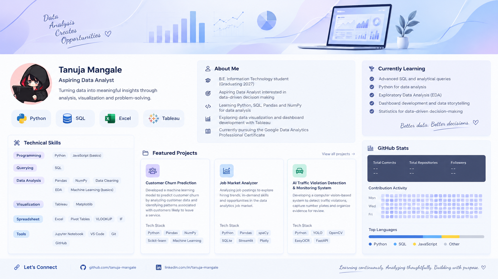

  

<h1 align="center">Hi, I'm Tanuja 👋</h1>

<h3 align="center">Aspiring Data Analyst | Python • SQL • Excel • Tableau</h3>

  Turning data into meaningful insights through analysis, visualization, and problem-solving.

  
  
  
  

---

## 👩‍💻 About Me

- 🎓 B.E. Information Technology student, graduating in 2027.
- 📊 Aspiring Data Analyst interested in data-driven decision-making.
- 🐍 Learning Python, SQL, Pandas, and NumPy for data analysis.
- 📈 Exploring data visualization and dashboard development with Tableau.
- 🌱 Currently pursuing the Google Data Analytics Professional Certificate.
- 🎯 Working towards building practical, industry-relevant analytics projects.

---

## 📂 Featured Projects

### 📊 Job Market Analyzer
Analyzing job postings to explore hiring trends, in-demand skills, and opportunities in the data analytics job market.

**Tech Stack:** Python, Pandas, spaCy, SQLite, Streamlit, Plotly

### 🚦 AI Traffic Violation Detection & Monitoring System
Developing a computer vision-based system to detect traffic violations, capture number plates, and organize evidence for review.

**Tech Stack:** Python, YOLO, OpenCV, EasyOCR, FastAPI

### 📉 Customer Churn Prediction

Developed a machine learning model to predict customer churn by analyzing customer data and identifying patterns associated with customers likely to leave a service.

**Tech Stack:** Python, Pandas, NumPy, Scikit-learn, Machine Learning

---

## 📈 GitHub Statistics

  
  

---

## 🤝 Let's Connect

  <a href="YOUR_LINKEDIN_URL">LinkedIn</a> •
  <a href="YOUR_GITHUB_URL">GitHub</a>

  <i>Learning continuously. Analyzing thoughtfully. Building with purpose.</i>

